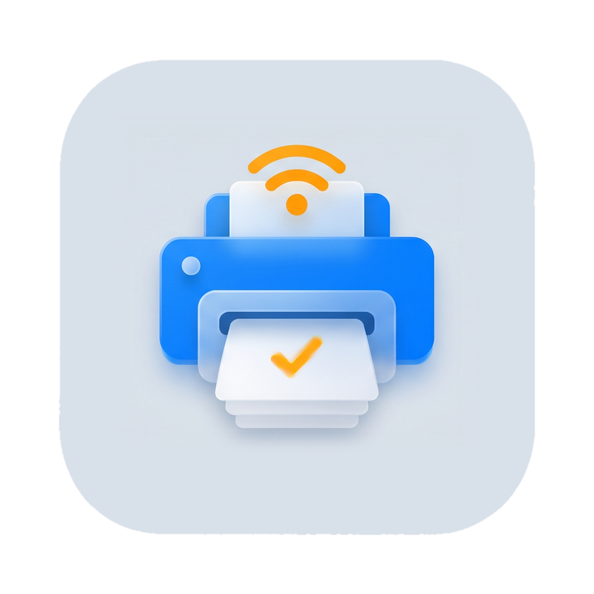
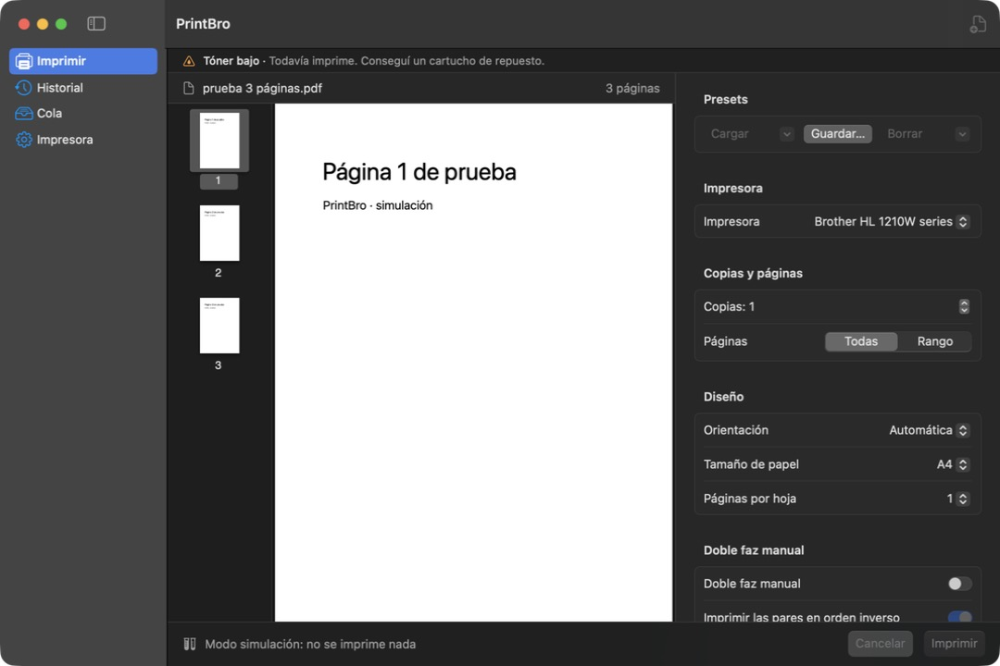
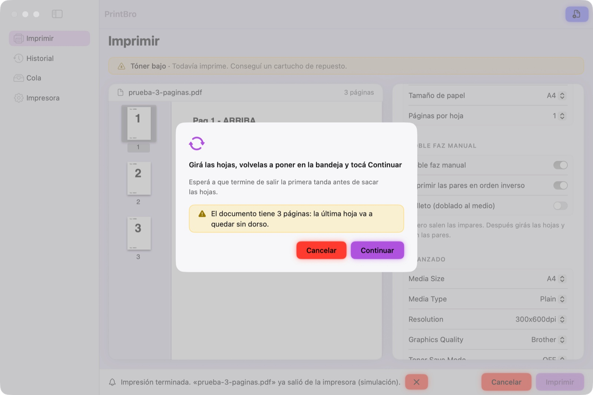
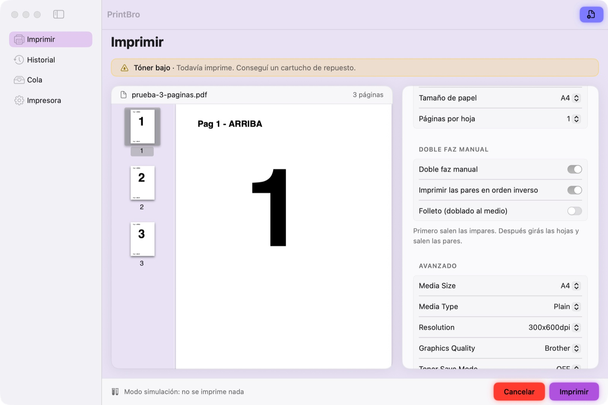
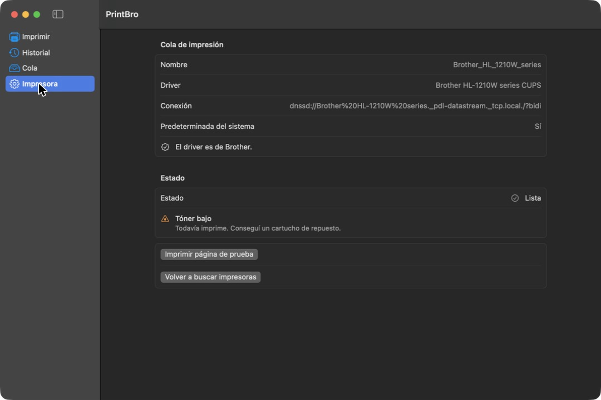

<p align="center"></p>

# PrintBro

App de Mac para imprimir en una Brother HL-1210W con doble faz manual y con todas las opciones que trae el driver.

Versión 0.1.0 (21 de noviembre de 2026). [Descargar](https://github.com/valentinocivetta04/PrintBro/releases/latest)

## El problema

Tengo una Brother HL-1210W: láser, monocromática, por WiFi, que solo imprime y no tiene doble faz automático. Quería imprimir de los dos lados y elegir la calidad, pero la app oficial de Brother para Mac (iPrint&Scan) no me ofrecía doble faz ni opciones de calidad para este modelo. Probé desde la terminal con `lp`, mandando primero las páginas impares y después las pares, hasta encontrar la combinación que deja cada página par en el dorso correcto con mi forma de girar la pila. Lo armé primero como un script de bash y después lo pasé a una app nativa.

## Lo que hice

PrintBro le habla directamente a CUPS, el sistema de impresión de macOS, y automatiza el doble faz manual: imprime las hojas impares, me avisa que dé vuelta la pila y después imprime las pares.

- Doble faz manual. Las impares salen con `page-set=odd` y las pares con `page-set=even` y `outputorder=reverse`, que viene activado porque con mi forma de girar la pila es lo que deja cada par en el dorso correcto. Si el documento tiene una cantidad impar de caras, avisa que la última hoja va a quedar sin dorso.
- Las opciones propias del driver (resolución, ahorro de tóner, tipo de papel, densidad, etc.) tal como las devuelve `lpoptions -l`.
- Copias, rango de páginas (con validación), orientación, tamaño de papel (A4 por defecto si el driver lo ofrece) y 1, 2, 4, 6 o 9 páginas por hoja.
- Folleto: reordena las páginas en un PDF temporal, dos por cara, para doblar la pila al medio.
- PDF, imágenes (PNG, JPG y HEIC) y texto plano. Las imágenes se pasan a un PDF temporal y se ajustan a la hoja.
- Vista previa del PDF con miniaturas de las páginas.
- Cola de impresión que se actualiza cada 2 segundos mientras la mirás, con botones para cancelar un trabajo o todos.
- Estado de la impresora con avisos en español: tóner bajo, sin tóner, sin papel, atasco, tapa abierta, pausada o sin conexión. El tóner bajo también aparece en una franja arriba de la pantalla de impresión y se puede seguir imprimiendo.
- Presets con nombre e historial de los últimos 20 trabajos, con un botón para reimprimir.
- Modo de prueba (`PRINTBRO_DRY_RUN=1`) que no manda nada a la impresora.

## Capturas

Tomadas con la app en modo de prueba, sin imprimir.

<p align="center"></p>

<p align="center"></p>

<p align="center"></p>

<p align="center"></p>

## Descargar

Si no querés compilarla, bajá `PrintBro-0.1.0.dmg` de la [página de versiones](https://github.com/valentinocivetta04/PrintBro/releases/latest), abrilo y arrastrá PrintBro a Aplicaciones. Está compilada solo para Macs con chip Apple (M1 o posterior).

Como está firmada ad-hoc, macOS la bloquea la primera vez que la abrís. Para habilitarla:

```bash
xattr -dr com.apple.quarantine /Applications/PrintBro.app
```

También podés intentar abrirla una vez y después buscar el botón "Abrir igual" en Configuración del Sistema > Privacidad y seguridad. En los dos casos necesitás el driver de Brother y la impresora agregada (ver Requisitos).

## Requisitos

- macOS 14 o posterior.
- Las Command Line Tools de Apple (`xcode-select --install`). No hace falta Xcode.
- Una Brother HL-1210W en la misma red.
- El driver "Brother HL-1210W series CUPS". Está en la [página de descargas de Brother para la HL-1210W en macOS 26](https://support.brother.com/g/b/downloadlist.aspx?c=es&lang=es&prod=hl1210w_eu_as&os=10088), en Controladores > "Controlador de impresora" (versión 1.5.0, incluye el controlador CUPS). Para macOS 27 Brother no publica este driver, solo el paquete completo, el firmware e iPrint&Scan, así que uso el de macOS 26, que funciona en mi Mac con macOS 27. El link es de la región España del sitio de Brother, porque en la de Latinoamérica este modelo no aparece.
- La impresora agregada en Configuración del Sistema > Impresoras y escáneres con ese driver. En mi Mac la cola se llama `Brother_HL_1210W_series`.

## Instalación

1. Cloná el repositorio:

   ```bash
   git clone https://github.com/valentinocivetta04/PrintBro.git
   cd PrintBro
   ```

2. Bajá e instalá el [controlador de impresora de Brother](https://support.brother.com/g/b/downloadlist.aspx?c=es&lang=es&prod=hl1210w_eu_as&os=10088) (ver Requisitos) y agregá la impresora desde Configuración del Sistema > Impresoras y escáneres.

3. Compilá. Esto arma `PrintBro.app` en la carpeta del proyecto, con el ícono y firmada ad-hoc:

   ```bash
   ./build.sh
   ```

4. Si querés, copiala a Aplicaciones (reemplaza la versión anterior si había una):

   ```bash
   ./build.sh --instalar
   ```

5. Abrila con doble clic o con `open PrintBro.app`. Como la compilás vos en tu Mac, la app no tiene el atributo de cuarentena que macOS les pone a los archivos descargados, así que Gatekeeper no la bloquea.

6. Entrá a la pantalla Impresora y fijate que en Driver diga "Brother HL-1210W series CUPS".

Para correr los tests:

```bash
./test.sh
```

Uso `./test.sh` en vez de `swift test` porque, con solo Command Line Tools, SwiftPM no encuentra el plugin de macros de Swift Testing y el script le pasa la ruta.

## Cómo la uso

### Doble faz

1. Abro el PDF: lo arrastro a la ventana, uso Archivo > Abrir o "Abrir con > PrintBro" desde Finder.
2. Activo "Doble faz manual" y toco Imprimir. Salen las páginas impares.
3. Cuando aparece el aviso, espero que termine de salir la primera tanda, doy vuelta la pila, la vuelvo a poner en la bandeja y toco Continuar. Salen las pares.

Si girás la pila de otra manera que yo, probá desactivar "Imprimir las pares en orden inverso". La app se acuerda de lo que elijas. El doble faz imprime el documento entero y una sola copia, así que mientras está activado no deja elegir rango ni copias. Con varias páginas por hoja cuenta caras impresas en vez de páginas: con 2 por hoja, 6 páginas son 3 caras.

### Folleto

Con "Folleto (doblado al medio)" la app arma un PDF temporal con dos páginas por cara en orden de folleto (para 8 páginas: 8 y 1, 2 y 7, 6 y 3, 4 y 5) y lo imprime con doble faz. Al terminar se dobla la pila al medio. El PDF original no se toca y el temporal se borra cuando termina o cancelás.

### Calidad y opciones del driver

En la sección Avanzado aparece una lista por cada opción que ofrece el driver. Con mi impresora son tamaño de papel, tipo de papel, resolución (300dpi, 300x600dpi o 2400x600dpi), calidad de gráficos, ahorro de tóner, mejoras de salida, saltear páginas en blanco y densidad. El tamaño de papel se manda siempre; del resto, a `lp` solo van las que cambiás.

### Cola de impresión

La pantalla Cola muestra los trabajos pendientes con número, archivo, estado y fecha. Consulta cada 2 segundos solo mientras la tenés abierta. "Cancelar todos" pide confirmación porque también cancela trabajos que no mandaste desde PrintBro.

### Modo de prueba

Para probar la interfaz sin gastar papel:

```bash
PRINTBRO_DRY_RUN=1 ./PrintBro.app/Contents/MacOS/PrintBro
```

En ese modo `lp` y `cancel` no se ejecutan (los argumentos se escriben en la terminal). Leer impresoras, opciones y estado sí es real.

## Problemas comunes

### Los trabajos figuran como completados pero no sale nada

Me pasó antes de instalar el driver correcto: la cola tenía un PPD equivocado (de DYMO) y CUPS marcaba los trabajos como completados sin imprimir nada. PrintBro lee el driver de la cola y, si no es de Brother, lo avisa en la pantalla Impresora. La solución fue borrar la cola y volver a agregar la impresora con el driver de Brother.

### Tóner bajo

Mi impresora lo reporta como `toner-low-report`: la luz naranja titila, pero sigue imprimiendo bien. PrintBro lo muestra como "Tóner bajo" y deja imprimir igual.

### La impresora está pausada

Aparece en la pantalla Impresora. Se reanuda desde Configuración del Sistema > Impresoras y escáneres; PrintBro no la reanuda sola.

### La última hoja salió sin dorso

Pasa con una cantidad impar de caras en doble faz, y la app lo avisa antes de que gires la pila.

### No aparecen notificaciones

En mi Mac, macOS rechaza las notificaciones de PrintBro con el error "Notifications are not allowed for this application". Sospecho que es porque la app está firmada ad-hoc, pero no lo confirmé. Por eso, cuando termina o falla un trabajo, el aviso aparece abajo en la ventana.

## Cómo está hecha

Es un Swift Package (swift-tools 6.0) sin dependencias externas: SwiftUI y AppKit para la interfaz, PDFKit para la vista previa, el folleto y las imágenes, y la API C de CUPS para leer impresoras, estado y cola.

```
PrintBro/
├── Package.swift
├── build.sh              compila, arma PrintBro.app y genera el ícono
├── test.sh               corre los tests con Command Line Tools
├── Sources/
│   ├── PrintBroCore/     lógica: CUPS, lp, doble faz, folleto, estado, presets
│   └── PrintBro/         interfaz SwiftUI y el modelo de la app
├── Tests/PrintBroTests/  72 tests, sin impresora
├── Resources/            textos en español e ícono
└── docs/                 ícono y capturas del README
```

Algunas decisiones y por qué las tomé:

- El doble faz es una máquina de estados (`idle`, `imprimiendoImpares`, `esperandoGiro`, `imprimiendoPares`, `listo`, `cancelado`) en `DuplexManual`. Así cancelar o reintentar después de un error tiene un comportamiento definido, y lo puedo probar sin papel.
- Los comandos se lanzan con `Process` y los argumentos van en un arreglo, sin pasar por una shell. Un archivo con espacios, comillas o `;` en el nombre llega a `lp` como un solo argumento, y hay un test para eso.
- Mi Mac está en español y `lpstat` devuelve texto traducido, así que no parseo texto localizado. Impresoras, estado y cola salen de la API de CUPS (`cupsGetDests`, `cupsGetJobs2`). De `lpoptions -l` uso la estructura de cada línea y no la etiqueta, y de `lp` y `cancel` solo miro el código de salida.
- No tengo Xcode, solo Command Line Tools, y ahí no viene el plugin de macros de `@State`. Por eso el estado de la interfaz vive en un modelo `@Observable`, y los textos van en un `Localizable.strings` en vez de un `.xcstrings`.
- Los tests no tocan la impresora: usan un `FakeRunner` que guarda los comandos que se hubieran ejecutado y devuelve la respuesta que le pido, así puedo comprobar los argumentos exactos de `lp` y `cancel`. Algunos usan salidas reales capturadas en mi Mac. Hoy son 72 y pasan con `./test.sh`.

## Limitaciones y qué falta

- Probé en papel tres cosas: el doble faz de un PDF de 4 páginas con orden inverso, que CUPS aplica `page-set` después de `number-up` (con 2 por hoja, la primera tanda sacó las páginas 1 y 2 en la misma cara), y cancelar la página de prueba desde la Cola antes de que saliera.
- Todavía no probé en papel: un documento de 3 páginas (impar) con orden inverso, 2 páginas por hoja con doble faz completo, y el folleto de 8 páginas (no sé si las caras pares salen derechas o de cabeza). Tampoco imprimí imágenes ni texto plano, y de los avisos de estado solo vi el de tóner bajo.
- La probé con una sola impresora, la mía. Las opciones avanzadas cambian con cada driver.
- La app está firmada ad-hoc, sin cuenta de desarrollador de Apple.
- Solo imprime: la HL-1210W no escanea ni copia. Tampoco convierte Word, Excel ni Pages; hay que exportarlos a PDF.
- La interfaz está solo en español.

## English summary

PrintBro is a native macOS app (SwiftUI, Swift Package, no external dependencies) I built to use my Brother HL-1210W laser printer, which has no automatic duplex. Brother's own Mac app didn't give me duplex or quality settings for this model, so PrintBro talks to CUPS directly. It automates manual duplex: it prints the odd pages, asks you to flip the stack, then prints the even pages in reverse order. It also exposes every option the driver reports, shows the print queue and printer status, and has a dry-run mode for testing without paper. Only part of it is verified on paper so far; see the limitations section above.

## Autor

Valentino Civetta, estudiante de la Tecnicatura Universitaria en Inteligencia Artificial (UNR, FCEIA), Rosario, Argentina.

- GitHub: [valentinocivetta04](https://github.com/valentinocivetta04)
- LinkedIn: [valentino-civetta-75719b368](https://www.linkedin.com/in/valentino-civetta-75719b368)

## Licencia

MIT. Ver [LICENSE](LICENSE).
